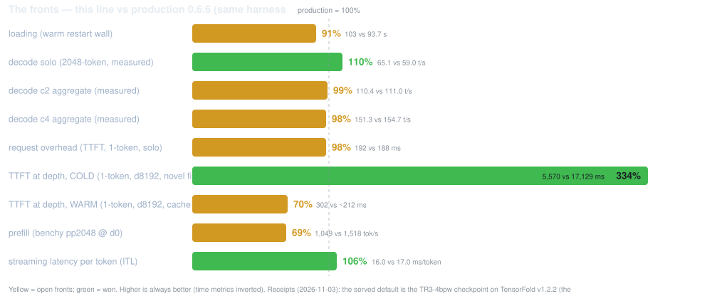

# GLM-5.3-Flash EXL3 on 2× GB10 — TensorFold native (the promoted line)

> ## 🤖 Provenance disclaimer
>
> **Every edit in this repository — code, scripts, and all documentation — was
> generated by an AI agent** (OpenCode running GLM, by Z.ai), working from measured
> receipts on the hardware this repo serves. Human review is the user's; the numbers
> come from the campaign runs under `results/` and the append-only log
> [docs/LAUNCH.md](docs/LAUNCH.md), not from imagination. Where a claim has no
> receipt behind it, the docs say so.

## What this repo is

**Production**: one GLM-5.3-Flash instance on TensorFold's **native CUDA engine**,
tensor-parallel over two GB10 hosts (one rank each, the ConnectX-7 rails carry the
gather), serving **opencode on port 8000**. Everything is Docker; the hosts need
nothing but docker, ssh and the NVIDIA driver.

- **Checkpoint**: Mia-AiLab's **TR3-4bpw EXL3** quant (`Mia-AiLab/GLM-5.3-Flash-EXL3-TR3-4bpw`,
  resharded locally to 55 shards) with the **DFlash2 drafter**; **vision on** as the
  standing default; **524,288-token window, 4 concurrent streams, fp8 paged KV**.
- **Engine**: TensorFold v1.2.6 + **the adopted 18-patch stack re-anchored**
  (`PATCHES` below; each patch's full record: [patches/README.md](patches/README.md);
  the v1.2.6 rebase's round-trip is proven byte-identical — pristine v1.2.6 + the
  18 patches = the rebase tree; the v126val battery QUALIFIED the pin —
  campaign-20261110-162034, the round-140 cont. 2 receipt).
- **Testing runs from this same repo**: a start FOR OPENCODE serves 8000; a start FOR
  TESTING serves 8001 (intent-keyed ports). Opencode never touches 8001; the quality
  gates never touch 8000. The lifecycle is autonomous — see *The autonomous loop*.
- **Comparisons are native-vs-native**: the duel's baseline arm is this repo's own
  promoted config on 8001; a candidate arm carries the window's `PATCHES`. The old
  Python-based recipe is retired ([its repo](https://github.com/gilesco/GLM-5.3-Flash-EXL3-2x-DGX-Sparks-TensorFold)
  points here).
- This line is **EXL3 only**; the NVFP4 route has its own repo
  ([GLM-5.3-Flash-NVFP4-2x-GB10-TensorFold-v1-testing](https://github.com/gilesco/GLM-5.3-Flash-NVFP4-2x-GB10-TensorFold-v1-testing)) —
  the two are not interchangeable (different checkpoint, memory model, receipts).

<p align="center">
  
</p>

## How it performs

<p align="center">
  
</p>

| question | answer |
| --- | --- |
| Quality | **Hardmode 95/104** on the shipping config — receipted twenty-six consecutive times, every one with the vision suite **4/4** and the §2 exactness gates **ALL PASS** (content form: drafted=plain, resumed=fresh, concurrent=solo, seeded sampling stable). The definitive cards: [docs/cards/](docs/cards/) — [docs/VALIDATION.md](docs/VALIDATION.md) |
| Context | **524,288 tokens qualified** end to end: the depth fact ladder **12/12** at 8k/64k/192k/384k — [docs/CONTEXT_512K_PLAN.md](docs/CONTEXT_512K_PLAN.md) |
| Speed | All three (user) fronts **CROSSED** against the retired Python recipe — loading 112.9%, solo decode 116.8% (the standing high), prefill 100.1%; the first **native-vs-native calibration pair** (both arms the promoted config) reads flat inside the ±2% band on every instrument: solo 99.1%, c2 99.4%, c4 99.3%, overhead 98.9%, cold depth 100.3%, ITL 100% (campaign-20261108-162810). Future candidate duels measure against that floor — the pairs: [docs/perf-anchors.tsv](docs/perf-anchors.tsv), the scoreboard: [docs/DELTAS.md](docs/DELTAS.md) |
| Resume | The concurrent 4-prefix resume is **−40% with the pool-pages store**; the solo warm resume is reliable; the cross-restart resume is receipted **COLD** (the store does not survive a restart) |
| Vision | **Enabled as the standing default** at the 524,288 window; the test assets and runner: `assets/vision/` via `scripts/vision-suite-probe.py` |

The checkpoint sweep's ranking (all four packs on the shipping stack): **TR3 95**
(the served pack), production's stock 92, the Focus 92, the AZ top-4 87 at the top
perf numbers: [docs/bpw4-sweep-cards.svg](docs/bpw4-sweep-cards.svg).

## Run it

### Requirements

- Two GB10 hosts (head + worker): docker + nvidia runtime, key-based ssh head → worker,
  ~200 GB free disk each (the checkpoints are ~164 GB).
- The checkpoints **on both** hosts in `~/.cache/huggingface` (`DOWNLOAD=1 ./scripts/prepare.sh`
  fetches a missing one).
- One CX7 cable per rail between the pair. `prepare.sh` **discovers the site** when
  `scripts/local.sh` is missing — the cabled rails, their addresses and the worker's
  ssh target — and writes it (`REDISCOVER=1 ./scripts/prepare.sh` re-detects);
  `local.sh.example` is the by-hand walkthrough. RoCE needs `NCCL_IB_HCA` set to the
  cabled devices (discovery sets it); without it NCCL falls back to TCP and the
  prefill win disappears.
- The build runs on the head inside `nvcr.io/nvidia/pytorch:26.07-py3` (arm64, has
  nvcc and NCCL); the resulting runtime image is small and is copied to the worker
  with `docker save | ssh docker load`.
- Site identity lives in `scripts/local.sh` (git-ignored); a prepared site's real
  values also live in `docs/SITE.md` (git-ignored).

### Serve

```sh
cp scripts/local.sh.example scripts/local.sh   # or skip this: prepare.sh discovers the site
./scripts/prepare.sh      # resolve version, preflight, build + distribute the image
./scripts/start.sh        # rank 1 on the worker first, rank 0 here, waits for /health
./scripts/status.sh       # containers, /health, last log lines
./scripts/stop.sh         # stops both, saves gzipped logs
```

- The port follows the intent: `PORT` defaults to **8001** (testing); production's
  own repo sets **8000**. Start FOR TESTING: `PORT=8001 ./scripts/start.sh`. Start
  FOR OPENCODE: run it from the production checkout (port 8000) — never probe or
  benchmark a live 8000.
- `DRY_RUN=1 ./scripts/start.sh` prints both ranks' docker commands and changes nothing.
- The first build compiles TensorFold (Zig + nvcc, sm_121) and takes a while; every
  later build with the same commit is a docker-cache hit.
- Then point any OpenAI-compatible client at `http://<head>:<port>/v1`, model name
  `GLM-5.3-Flash-EXL3` (`SERVED_NAME`).

### Test it

```sh
PHASES="knobs kvqual4 throughput depth prefill" ./scripts/run-qualification.sh
```

`run-qualification.sh` is phased (`.done` markers, resumable, `FORCE=1` re-runs),
production-guarded (GPU phases refuse while production is up — the window wrapper
owns the stop), and lands one receipt directory under `results/campaign-*` per run.
See its header for the per-phase list. Every quality/perf metric runs on the clean
testing port; the vision suite runs against the same serve via
`scripts/vision-suite-probe.py`.

### The autonomous loop

The standing mode: a sitting finishes its work, launches **one** window
(`scripts/autonomous-launch.sh "phase summary"`), and goes dark. The window stops
production, runs the phases, restores production on **every** exit path; the head's
cron (`autonomous-cron.sh`) restarts production if it is ever down with no window
running; the agent host's cron (`autonomous-poke.sh`) wakes the session when a
campaign completes — the woken sitting digests the receipt and launches the next
window last. The rules and the gotchas: [AGENTS.md](AGENTS.md); the round-by-round
receipts: [docs/LAUNCH.md](docs/LAUNCH.md).

## Configuration

All settings live in `config.sh` (defaults) and `scripts/local.sh` / `.env` (this
site's). The ones that matter:

| Variable | Default | Meaning |
| --- | --- | --- |
| `WORKER` | *(required)* | rank 1's ssh target (key-based); set in `scripts/local.sh` |
| `HEAD_FABRIC_ADDR` / `WORKER_FABRIC_ADDR` | *(required)* | the CX7 rails; NCCL bootstraps on the head's |
| `NCCL_SOCKET_IFNAME` / `NCCL_IB_HCA` | *(required)* | netdevs NCCL may use; the two cabled RoCE devices for the engine's gather and NCCL RDMA |
| `PROD_REPO` | *(required by the autonomous scripts)* | the production checkout's dir name on this host — the window flow's stop/restore path and the poke's live check anchor it |
| `TF_REF` / `TF_COMMIT` / `TF_REPO` | latest v1.\* release / upstream | the TensorFold line to track; **pin in `local.sh`, never the session env** — `start.sh`'s auto-prepare re-resolves the default whenever the config fingerprint changes and silently drops a shell pin |
| `MODEL_ID` / `MODEL_REVISION` | `Mia-AiLab/GLM-5.3-Flash-EXL3-TR3-4bpw` @ `main` | the checkpoint; present on both hosts |
| `PATCHES` | the 18-patch stack (below) | the adopted engine modifications; empty = stock engine |
| `DFLASH2_ID` / `DFLASH2_REVISION` | `incoai/GLM-5.3-Flash-DFlash2` @ `bf582e4e…` | the drafter passed as `--drafter` when `DRAFTS=1` (CC BY-NC-ND 4.0, non-commercial) |
| `CONTEXT` | `524288` | the window — the qualified optimum |
| `PARALLEL` | `4` | concurrent streams |
| `DRAFTS` | `1` | `0` → `--no-drafts` (the serial reference); `1` drafts with DFlash2 (else the checkpoint's MTP head) |
| `KV_CACHE` | `fp8` | `--kv-cache fp8`: halves per-token latent cache bytes; all §2 gates PASS on it at 524,288. Empty = the engine default bf16 (the literal `bf16` is refused) |
| `TF_KV_PAGES` | `on` | the elastic paged KV pool (512-row pages shared across streams); `off` reverts to window-mode KV; an EMPTY value is refused |
| `TF_KV_SHARE` | `16` | how many kept prompt-cache states live as pool pages (the host store off); v1.2.4 floors it at 4× `PARALLEL` |
| `DENSE_BITS` | `4` | pack the dense linears at load: the measured speed leader (monotonic 4<6<8<16) |
| `HEAD_BITS` | `4` | the same packing for the head |
| `VISION` | `1` | `--vision --vision-image-tokens 2048`; `0` serves text-only |
| `TF_GLM_INDEX_CUDA` | `1` | the DSA indexer's dedicated CUDA kernels — the TTFT gains grow with depth; `0` compares |
| `TF_GLM_ABSORB_MMA` | `1` | a prompt pass's absorb_q/expand_v as tensor-core GEMMs (fp32 sums; decode windows keep the SIMT kernels); `0` off |
| `TF_GLM_PROMPT_STEPS` | `0` | the draft prompt-steps builder off — the depth-decode serving default (d8192 c2 48.2/37.0 vs the 17.3 floor with the builder on; the confirm receipt campaign-20261108-214221) |
| `PDL` | `0` | `1` → programmatic dependent launch on the mm kernels (hurt dense4 — retired from the default) |
| `RECALL` / `PROMPT_CACHE_GIB` | `0` / empty — CLOSED | the drafts-copy-from-text cache; the kept-states store's size cap. The #2699 value-first battery (window 36) measured the funded cache at no resume value the page cache does not already deliver, at the cost of a 512K window + 1 GiB of stream room — the cacheless standing holds |
| `TF_PROMPT_CACHE_FIRST` | `1` | the prompt cache is set aside before the streams' windows are counted (020-cachefirst); `0` restores windows-first |
| `SERVED_NAME` / `PORT` / `HOST` | `GLM-5.3-Flash-EXL3` / `8001` / `0.0.0.0` | the API surface |
| `API_KEY` | empty | recommended; sent as `Authorization: Bearer` |
| `MEMORY_LIMIT_GB` | engine default | → `TENSORFOLD_CUDA_MEMORY_LIMIT_GB` |
| `BASE_IMAGE` / `ZIG_VERSION` / `SM_ARCH` | NGC pytorch 26.07 / `0.17.0` / `121` | the builder |

### The 18-patch stack (`PATCHES`)

The image applies the patches **in filename order — the three-digit prefix IS the
application order** (`001-` first, `.done` numbers are never reused; the next
port takes the next free number). What each does:

| Patch | What it does |
| --- | --- |
| `001-absorb-mma` | a prompt pass's absorb_q/expand_v as tensor-core GEMMs (`TF_GLM_ABSORB_MMA=0` off) |
| `002-exl3prompt` | the EXL3 prompt path in one call a pass; the down kernel writes slot rows straight (`TF_GLM_EXL3P=0` the pre-port path) |
| `003-fp8-pages` | E4M3 latent KV caches on the elastic page pool (the `TF_KV_PAGES=on` mode) |
| `004-packed-s2` | the packed-prompt matmuls in two stages (`TF_GLM_MM_P2=0` the pre-port path) |
| `005-pagerows-fix` | the paged E4M3 tables' page_rows correction |
| `006-selist-fix` | the prefill's sparse selection stays logical for E4M3 |
| `007-attnfetch8` | the latent attention's FP8 key tiles load 8 bytes a time, a tile ahead |
| `008-loaddirect` | the layer loads stream via checkpoint.direct (`TF_LOAD_DIRECT=0` keeps the read-ahead) |
| `009-moeside` | the shared expert runs beside the routed experts on a second stream (`TF_GLM_SHARED_SIDE=0` off) |
| `010-tools256` | a call to a tool the request did not offer goes out under its own name (server-layer; no knob) |
| `011-zclose` | the tool-call envelope closer scans value-aware — quoted markup inside a call's own arguments is data, not the closer (server-layer; no knob) |
| `012-zmoe-fuse` | the decode MoE glue fused into single kernels (`TF_GLM_MOE_FUSE=0` unfuses) |
| `013-zprompt` | the prompt experts' main loop reworked (`TF_GLM_EXL3P=0` the pre-port kernels) |
| `014-zs2` | the packed prompt GEMMs' per-block loads + bf16 pair decode (`TF_GLM_MM_P2=0`) |
| `015-zshfl` | the 4-bit grouped experts read every trellis word once (`TF_EXL3_SHFL=0`) |
| `016-zstep` | the decode chain launches as dependent kernels (`TF_EXL3_PDL=0`) |
| `018-callquote` | a call after prose that quotes its opener is still a call — the envelope closer scans value-aware (server-layer; no knob) |
| `020-cachefirst` | the prompt cache is set aside before the streams' windows are counted (`TF_PROMPT_CACHE_FIRST=0` windows-first); the fund-report line prints when the room funds less than `PROMPT_CACHE_GIB` asks |

Every patch's provenance, port receipts and knobs: [patches/README.md](patches/README.md).

### Checkpoint revisions

| Revision | What it is |
| --- | --- |
| `Mia-AiLab/GLM-5.3-Flash-EXL3-TR3-4bpw` *(default)* | Mia's TR3 4bpw (topk=8, mcg); real files on both hosts |
| `local/GLM-5.3-Flash-AZ-Focus-EXL3` | AxonZeta's efficiency-track Focus (topk=8, old-format mcg, integer bits); real files on both hosts |
| `Mia-AiLab/GLM-5.3-Flash-EXL3-4bpw-TensorFold` @ `top4cfg` | the top-4 variant of the stock pack (needs `PATCHES=017-topk4b.patch`) |
| `local/GLM-5.3-Flash-AZ-EXL3` | AxonZeta's AZ top-4 selector serve (needs `PATCHES=017-topk4b.patch`) — the sweep's perf leader at 87/104 hardmode |
| `Mia-AiLab/GLM-5.3-Flash-EXL3-4bpw-TensorFold` *(stock)* | the stock pack; already in both caches |
| `incoai/GLM-5.3-Flash-DFlash2` | the drafter; already in both caches (non-commercial terms) |

The ranks cross-check every byte before serving, so a mixed pair stops loudly.

## Coexistence and rollback

Production and a testing serve are separate deployments (different container names —
`glm53-native-tf` vs `glm53-native-tf-test` — and kernel/state/log dirs) sharing the
GPUs and the HF caches. The lifecycle is autonomous: the window flow stops production
for GPU windows and restores it on every exit path; the crash-net restarts it whenever
it is down with no window running. To take the GPUs manually: stop production through
the production repo's own `scripts/stop.sh`, run the testing serve, restore
production the same way — **never** leave an idle stack holding both GPUs. Do not
delete checkpoint blobs from the HF caches — this line and the NVFP4 line serve from
the same caches.

## The docs — what gets stored where

| Doc | What it holds |
| --- | --- |
| **README.md** (this file) | **the current state only** — what this is, how it performs, how to run it, the knobs; no history |
| [AGENTS.md](AGENTS.md) | **the working conventions for agents**: the boundaries, the loop, the gotchas — read it before working here |
| [docs/DELTAS.md](docs/DELTAS.md) | the current scoreboard — the per-metric comparison and its receipts |
| [docs/PERF_PLAN.md](docs/PERF_PLAN.md) | the perf frontier: the levers, the prices, the attack order, the next step |
| [docs/TOOL_EVAL_TESTING.md](docs/TOOL_EVAL_TESTING.md) | the matrix, the campaign phases, the result tables and open items |
| [docs/LAUNCH.md](docs/LAUNCH.md) | the append-only session log — every round's receipts and decisions (ALL history lives here, never in the README) |
| [docs/VALIDATION.md](docs/VALIDATION.md) | the gate definitions (§2 exactness, §3 capacity, §4 speed) and their receipts |
| [docs/CONTEXT_512K_PLAN.md](docs/CONTEXT_512K_PLAN.md) | the context ladder's math and outcome |
| [docs/ECOSYSTEM.md](docs/ECOSYSTEM.md) | the upstream watch: releases, issues, PRs, what transfers |
| [docs/perf-anchors.tsv](docs/perf-anchors.tsv) + `perf-vs-production.svg` | the chart's data and its generated SVG (never hand-edited — render with `scripts/render-perf-chart.sh`) |
| [docs/bpw4-sweep.tsv](docs/bpw4-sweep.tsv) + `bpw4-sweep-cards.svg` | the checkpoint sweep's scorecards (rendered by `scripts/render-sweep-cards.sh`) |
| [docs/SITE.md](docs/SITE.md) *(git-ignored)* | this site's real values (hostnames, addresses, devices) |
| [MODEL_CARD.md](MODEL_CARD.md) | the model card for the forums |
| [patches/README.md](patches/README.md) | **every patch's record** — provenance, port notes, knobs, status |

## Provenance

- **This repository's edits are AI-generated** (see the disclaimer at the top); the
  deployment shape and script conventions follow
  [MiaAI-Lab's EXL3 recipe](https://github.com/MiaAI-Lab/GLM-5.3-Flash-EXL3-2x-DGX-Sparks-TensorFold)
  (this repo started as its testing fork; the deployment has since diverged completely).
- The served engine is [ashhart/TensorFold](https://github.com/ashhart/TensorFold) at
  the pinned ref; the GLM CUDA family first shipped with PR
  [#804](https://github.com/ashhart/TensorFold/pull/804) (tracker:
  [#593](https://github.com/ashhart/TensorFold/issues/593)); the EXL3 two-rank and
  DFlash2 work is #855/#976 and #979, first released in v1.1.0. Apache-2.0; see
  LICENSE, NOTICE and upstream's THIRD_PARTY_NOTICES.
- The checkpoints carry their own terms: the TR3 pack (ShapleyMCG License 1.0,
  attribution asked), the stock pack and the sweep packs (Apache-2.0), the drafter
  (CC BY-NC-ND 4.0, non-commercial) — each pack's license and card apply when served;
  the GLM-5.3-Flash base is Z.ai's (MIT).
