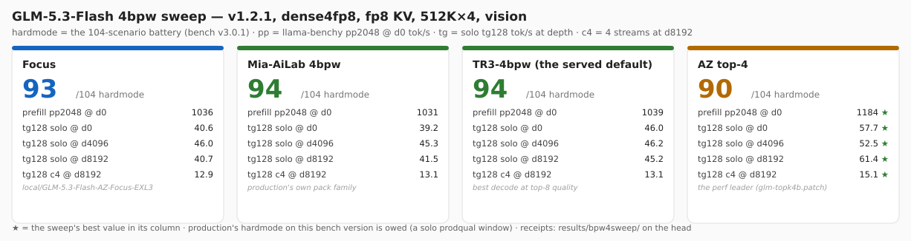

# GLM-5.3-Flash EXL3 on 2× GB10 — TensorFold native (ZIG testing line)

> ## 🤖 Provenance disclaimer
>
> **Every edit in this repository — code, scripts, and all documentation — was
> generated by an AI agent** (OpenCode running GLM, by Z.ai), working from measured
> receipts on the hardware this repo serves. Human review is the user's; the numbers
> come from the campaign runs under `results/` and the append-only log
> [docs/LAUNCH.md](docs/LAUNCH.md), not from imagination. Where a claim has no
> receipt behind it, the docs say so.

> ## ⚠️ Testing line — significantly different from the production recipe
>
> **This line is EXL3 only**: it serves the site's **TR3-4bpw** EXL3 checkpoint
> (Mia-AiLab's TR3 quant — the round-132 (user) swap after the 4bpw sweep: 94/104
> hardmode with the best top-8 decode) with the DFlash2 drafter (`--drafter`) on
> TensorFold's native CUDA engine — the two-rank path upstream has measured since
> v1.1.0. **The NVFP4 route has its own repo**
> ([GLM-5.3-Flash-NVFP4-2x-GB10-TensorFold-v1-testing](https://github.com/gilesco/GLM-5.3-Flash-NVFP4-2x-GB10-TensorFold-v1-testing));
> the two lines are not interchangeable (different checkpoint, different memory model,
> different receipts). **Vision is served here** as the standing default (the tower
> loads BF16 from the checkpoint's 347 `model.visual.*` tensors; verified
> production-equivalent perception — [docs/DELTAS.md](docs/DELTAS.md)).
>
> This is **not** the production deployment: production is the EXL3/Python recipe
> ([MiaAI-Lab's EXL3 recipe](https://github.com/MiaAI-Lab/GLM-5.3-Flash-EXL3-2x-DGX-Sparks-TensorFold),
> the `-tip` checkout on the head) and remains the prefill and quality reference.

One GLM-5.3-Flash instance, tensor-parallel over the ConnectX-7 link: rank 0 runs the
engine and the API, rank 1 holds its share of every axis and follows rank 0's steps over
NCCL. Everything is Docker; the hosts need nothing but docker, ssh and the NVIDIA driver.

<p align="center">
  
</p>

## Current status

<p align="center">
  
</p>

<p align="center">
  
</p>

The served default is the **TR3-4bpw checkpoint** (Mia-AiLab/GLM-5.3-Flash-EXL3-TR3-4bpw, reshared locally **120 → 55 shards** — byte-identical tensors, round 135: checkpoint.direct's gather draws on at most 64 files and every one of the pack's 120 held language_model tensors; the round-132 (user) swap after the 4bpw sweep — 94/104 hardmode, the best top-8 decode) on **TensorFold v1.2.4** (the pin in
`scripts/local.sh`; the round-127 tail-release patch retired — #1884 mainlined it). Fully qualified end to end; the receipts live in
the trackers below. This README carries the current status only — every detail links to
its tracker.

| question | answer |
| --- | --- |
| Does it serve? | Yes — **v1.2.4 + the 13-patch stack + TF_KV_SHARE=16** on both ranks (the round-133/134 adoptions: absorb + the fp8-pages marriage + the pagerows/selist fixes + packed-s2 + exl3prompt + attnfetch8 + moeside — rebased onto v1.2.4 in round 135 — plus glm-zz-loaddirect, the layer loads on v1.2.4's checkpoint.direct; TF_KV_PAGES=on, the prompt cache over the pool's pages). Qualified on v1.2.4 (v124val, campaign-20261107-132414): §2 gates ALL PASS, hardmode 95 + the vision 4/4, zero strict-TF_ refusals under #2405, the arms content-identical. The v1.2.3-era receipts stand: §2 gates ALL PASS on the fp8-paged cell (pagedgatesv123, campaign-20261106-084338) and the bf16 cell (kvqual4P, campaign-20261106-081942), the depth ladder 12/12, the replay 100 + the probe 5/5 (v123qual, campaign-20261106-065920), the bare-config smoke verified (adoptsmoke2, campaign-20261106-103510), RoCE gather up (2 HCAs, RDMA writes, no fallback). **The loading front CROSSED (112.9% — 83 s on the direct reads)** — the second of the (user) bar's three fronts (solo 112.3% crossed; prefill 96.0% remains the closest gap); the duel re-pair re-dates the v1.2.3-era speed rows |
| Ports | **This line always serves the testing port 8001** — opencode never connects to it. Production serves opencode on 8000 and testing on 8001 (intent-keyed starts). [AGENTS.md](AGENTS.md) carries the lifecycle rules |
| Exactness | All §2 gates **PASS** (content form) on the current stack: drafted=plain, resumed=fresh (the pool-page resume path receipted), concurrent=solo, seeded sampling stable — pagedgatesv123, campaign-20261106-084338 — [docs/VALIDATION.md](docs/VALIDATION.md) §2 |
| Context | **524,288 tokens qualified** end to end: the depth fact ladder **12/12** at 8k/64k/192k/384k, re-receipted on the paged v1.2.3 stack (campaign-20261106-081942) — [docs/CONTEXT_512K_PLAN.md](docs/CONTEXT_512K_PLAN.md) |
| Quality | **Hardmode 95** on the shipping config — receipted seven times with **total_tokens 662,693 byte-identical to the standing run's profile** (v123qual campaign-20261106-065920, pagedquality3 campaign-20261106-043015, kvsharequal campaign-20261106-093921, mms2qual campaign-20261106-185208, exl3qual campaign-20261106-212157, attnqual campaign-20261107-020420, moesidequal campaign-20261107-092913 on the moeside adoption) — a point **above** production's current-bench anchor 94/104 (the prodbench receipt, campaign-20261102-213954: the same instrument, bench_cell v3.0.1, on the clean 8001). The vision suite **4/4** on every receipt. The sweep's scorecards are the **CURRENT ranking** — the re-sweep (2026-11-06) put all four packs on the shipping stack: **TR3 95** (the served pack, 3 points clear), production's stock 92, the Focus 92, the AZ top-4 87 at the top perf numbers: [docs/bpw4-sweep-cards.svg](docs/bpw4-sweep-cards.svg) — [docs/DELTAS.md](docs/DELTAS.md) |
| Speed | The SHFL duel re-pair (production-for-testing on 8001 vs ours on the adopted 13-patch engine — campaign-20261108-010714, both engines the same window, the same probes): loading **112.9% — CROSSED** (83 vs 93.7 s — the direct reads, v124val campaign-20261107-150250); solo **115.2% — CROSSED** (67.2/67.7 vs 58.6/58.5 t/s — every row holds within noise on the SHFL engine, decode-neutral as the A/B read); c2 **107.2% — above production even at its top-of-range volley** (118.0 vs 110.1 this run; its floor 86.4 — 136.6% there; the record 118.6 stands); c4: production **at its floor this run** (168.0 vs 154.5 — **108.7%**; its range 155-241 with cache state; the record 168.9 stands, held at 168+ four windows); TTFT overhead **99.5%** (183 vs 184 ms); **the cold depth cost CROSSED (449%)** — ours 3.8 s vs production's 17.1 s true cold at d8192 (ours 3,812 ms, slope 0.443 — the prefill levers show at depth too; production's cold slope 2.026 ms/tok, slowing with depth; the 2.5 s it shows in-window is its persistent cache, not cold); the warm solo TTFT **70%** of production's full-hit skip (0.302 vs 0.21 s); ITL **116% — crossed** (14.8 vs 17.1 ms/token); prefill **100.1% — CROSSED, the last uncrossed (user)-bar front falls** (1,519 vs 1,518 tok/s — the P2 packed-prompt loads' lever: the bench pp d0 1,519 vs the 1,495 the exl3p window read and the 1,458-1,468 before it, and the A/B's second instrument agrees — the duel_arm TTFT slope 0.448 → 0.441, −1.6%; the exl3prompt patch took the front from 76% to 94.4%, the attention prefetch to 96.0%, the prompt experts' loop rework to 98.5%, the packed-prompt loads to 100.1%; production cited from the round-129 same-day pair — the duel re-pair that follows re-pairs same-window). The resume front: the concurrent 4-prefix resume **−40% with the pool-pages store** (7.41 vs 12.29 s, adopted 2026-11-06) and the solo warm reliable; the cross-restart resume is receipted **COLD** (the store does not survive a restart). The scoreboard: [docs/DELTAS.md](docs/DELTAS.md); the chart: [docs/perf-vs-production.svg](docs/perf-vs-production.svg) |
| Vision | **Enabled as the standing default** at the 524,288 window; verified production-equivalent perception — [docs/DELTAS.md](docs/DELTAS.md) |
| The bars | **(user)** quality — hardmode: beat production's run-level or come close (**met above the bar: 95 vs 94**, receipted three times on the current stack); perf — surpass production on loading, generation tok/s, and prefill. Loading is at 91% (the re-take is open); solo, ITL and the cold depth cost are CROSSED, c4 at parity, prefill at 96.0% (the last open front, nearly closed — exl3prompt took it from 76% to 94.4%, the attention prefetch to 96.0%); loading at 91% is the other open front (the re-take is open); the perf fronts' states: [docs/PERF_PLAN.md](docs/PERF_PLAN.md) |

The benchmark cards and the per-run graphics render in the bench's web UI (from the
head: `~/tool-eval-bench/.venv/bin/tool-eval-bench serve`). `docs/cards/` holds the
current pairing's cards — **`tr3-definitive.svg`** (the shipping config's receipted
battery: hardmode 95, the byte-identical token profile — kvsharequal, campaign-20261106-093921)
and **`prod-definitive.svg`** (production's current-bench anchor: 94/104 — the prodbench
receipt, campaign-20261102-213954, the same instrument) — plus the round-108-era cell
cards (the Focus, top4cfg, the old bench eras) as history. The current numbers live in
[docs/DELTAS.md](docs/DELTAS.md).

## Requirements

- Two GB10 hosts (head + worker): docker + nvidia runtime, key-based ssh head → worker,
  ~200 GB free disk each (the served checkpoints are ~164 GB; the Mia line's cells
  are ~176 GB).
- The checkpoints **on both** hosts: the served default (the TR3 pack) lives in
  `~/.cache/huggingface` on both (staged by the sweep; `DOWNLOAD=1 scripts/prepare.sh`
  fetches a missing one); the AZ-Focus is the local-files pack
  (`local/GLM-5.3-Flash-AZ-Focus-EXL3` — see the revisions table below).
- One CX7 cable per rail between the pair. `prepare.sh` **discovers the site** when
  `scripts/local.sh` is missing — the cabled rails, their addresses and the worker's
  ssh target — and writes it (`REDISCOVER=1 ./scripts/prepare.sh` re-detects an
  existing site); `local.sh.example` is the by-hand walkthrough. RoCE needs
  `NCCL_IB_HCA` set to the cabled devices (discovery sets it; see `local.sh.example`);
  without it NCCL falls back to TCP and the prefill win disappears.
- The build runs on the head inside `nvcr.io/nvidia/pytorch:26.07-py3` (arm64, has nvcc and
  NCCL — pull it if absent); the resulting runtime image is ~a few hundred MB and is copied
  to the worker with `docker save | ssh docker load`.
- Site identity lives in `scripts/local.sh` (git-ignored — `local.sh.example` has the shape;
  a prepared site keeps its real values in `docs/SITE.md`, also git-ignored).

## Quick start (on the head)

> **Production coexistence is autonomous**: the window flow stops production for GPU
> windows and restores it on every exit path; the crash-net restarts it whenever it is
> down with no window running. The ports are intent-keyed — this line serves 8001;
> production serves opencode on 8000 and testing on 8001. The rules:
> [AGENTS.md](AGENTS.md); the lifecycle receipts: [docs/LAUNCH.md](docs/LAUNCH.md).

```sh
cp scripts/local.sh.example scripts/local.sh   # or skip this: prepare.sh discovers the site
./scripts/prepare.sh      # resolve version, preflight, build + distribute the image
./scripts/start.sh        # rank 1 on the worker first, rank 0 here, waits for /health — serves 8001
./scripts/status.sh       # containers, /health, last log lines
./scripts/stop.sh         # stops both, saves gzipped logs
```

- `DRY_RUN=1 ./scripts/start.sh` prints both ranks' docker commands and changes nothing.
- `DOWNLOAD=1 ./scripts/prepare.sh` fetches the checkpoint into the head's HF cache (and
  rsyncs it to the worker) when a host lacks it.
- Verify what serves: `./scripts/status.sh` (containers, /health, the serve line — the
  memory shape, the drafts, the window) or `curl -s http://localhost:8001/v1/models`.
- The first build compiles TensorFold (Zig + nvcc, sm_121) and takes a while; every later
  build with the same commit is a docker-cache hit.

Then point any OpenAI-compatible client at `http://<head>:8001/v1`, model name
`GLM-5.3-Flash-EXL3` (`SERVED_NAME`) — or run the whole evidence chain in one command:

```sh
PHASES="knobs kvqual4 throughput depth prefill" \
  ./scripts/run-qualification.sh
```

`run-qualification.sh` is phased (`.done` markers, resumable), production-guarded, and
captures a reference probe from production if it is up before touching anything. See its
header for the per-phase list.

## Versions: how the pin works

The pin lives in `scripts/local.sh` (`TF_REF` or `TF_COMMIT`): the current pin is
`TF_COMMIT=267c5af6a…` (**v1.2.4** — the round-135 rebase, qualified by the
`v124val` window: the §2 gates ALL PASS, hardmode 95 (the eighth consecutive),
the vision 4/4, zero strict-TF_ refusals under #2405; the loading row stands
pending the direct reads' re-take on the resharded pack). At prepare time the ref is resolved and **recorded in the prepared
marker**, so a running pair never drifts and a restart does not silently upgrade.

> **Pin in `scripts/local.sh`, not in your shell.** `start.sh` re-runs `prepare.sh`
> automatically whenever the config fingerprint changes (a knob change, a window change) —
> and that re-run does not inherit your session's environment, so a ref set only in the
> shell is silently replaced by the default. A pin in `local.sh` survives every
> auto-prepare.

## Configuration

All settings live in `config.sh` (defaults) and `scripts/local.sh` / `.env` (this site's).
The ones that matter:

| Variable | Default | Meaning |
| --- | --- | --- |
| `WORKER` | *(required)* | rank 1's ssh target (key-based); set in `scripts/local.sh` |
| `HEAD_FABRIC_ADDR` / `WORKER_FABRIC_ADDR` | *(required)* | the CX7 rails; NCCL bootstraps on the head's |
| `NCCL_SOCKET_IFNAME` / `NCCL_IB_HCA` | *(required)* | netdevs NCCL may use; the two cabled RoCE devices for the engine's gather and NCCL RDMA |
| `TF_REF` / `TF_COMMIT` / `TF_REPO` | `v1.2.4` (via local.sh) / upstream | the TensorFold line to track; pin via `local.sh` (see above) |
| `MODEL_ID` / `MODEL_REVISION` | `Mia-AiLab/GLM-5.3-Flash-EXL3-TR3-4bpw` @ `main` | the checkpoint — the TR3 quant (the round-132 (user) swap; 94/104 hardmode, the best top-8 decode); present on both hosts (staged) |
| `PATCHES` | `glm-mia-absorb-mma.patch glm-mia-fp8-pages.patch glm-mia-pagerows-fix.patch glm-mia-selist-fix.patch glm-mia-packed-s2.patch glm-mia-exl3prompt.patch glm-zz-attnfetch8.patch glm-zz-loaddirect.patch glm-zz-moeside.patch glm-zz-zmoe-fuse.patch glm-zz-zprompt.patch glm-zz-zs2.patch glm-zz-zshfl.patch` | **the adopted 13-patch stack (the round-133/134 adoptions + the round-135 ninth, rebased onto v1.2.4 + the round-136 tenth + the round-137 eleventh, twelfth and thirteenth)** — the Mia-1104 ABSORB_MMA port (a prompt's absorb_q/expand_v as tensor-core GEMMs, opt-out `TF_GLM_ABSORB_MMA=0`; the deep fills −6.8/−7.0/−6.9%) + the fp8-pages marriage (E4M3 latent caches on the KV pages — `TF_KV_PAGES=on` below) + the pagerows fix (the E4M3 Tables' page_rows) + the selist fix (the prefill's E4M3 token lists stay logical — the loop bug). The fifth patch (the s2 two-stage packed-prompt matmuls — Mia 1104 0009): the content BIT-IDENTICAL across arms (campaign-20261106-174454), pp +3.4/+5.8/+6.7% at d0/d4096/d8192, §2 PASS + hardmode 95 + the vision 4/4 (mms2qual, campaign-20261106-185208). The sixth patch (the EXL3 prompt path in one call a pass + the down kernel writing the MoE slot rows straight + no target-MTP prompt absorption beside a drafter — Mia 1104 0007+0008 hand-ported, byte-identical to the port commit on a fresh v1.2.3 checkout): the content BIT-IDENTICAL across arms (campaign-20261106-201824), pp +24.5/+22.7/+23.3% at d0/d4096/d8192 — exceeding Mia's +12.6-16% combined claim, the prefill front 76% → 94.4% — §2 PASS + hardmode 95 + the vision 4/4 (exl3qual, campaign-20261106-212157). The seventh patch (the latent attention's FP8 key tiles load 8 bytes at a time, a tile ahead — the reads overlap QK/softmax/PV, the shared-memory keys are the same bits; Mia 1104 0005+0011 hand-ported onto the paged marriage, named `glm-zz-` to sort after the stack — the image applies patches alphabetically): the content BIT-IDENTICAL everywhere including the 2048-token decode replies (campaign-20261107-010849), bench pp +1.7/+3.6-4.3% and tg +2.9/+3.3/+4.7/+5.8/+10.9% at every depth cell, §2 PASS + hardmode 95 + the vision 4/4 (attnqual, campaign-20261107-020420), the duel's solo 109.4% beyond its band and the cold depth 3,942 ms (434% of production's true cold). The eighth patch (a decode window's MoE shared expert on a second stream beside the routed experts — the fork after the block's input, the join before the slot combine, the bits the same; TF_GLM_SHARED_SIDE=0 the kill switch; Mia 1104 0006+0010 hand-ported, `glm-zz-` named to sort after the stack): the content BIT-IDENTICAL everywhere including the 2,048-token essay replies (campaign-20261107-083254), the steady-state probe RESOLVED (the off arm 51/51 s, both on-runs faster, +3.0% 4/4 sign-consistent), §2 PASS + hardmode 95 + the vision 4/4 (moesidequal, campaign-20261107-092913), the duel's solo 112.3% — +2.9% over the ATTN8 pair with two instruments agreeing. The ninth patch (glm-zz-loaddirect, round 135): GLM's layer loads on v1.2.4's checkpoint.direct — each layer's tensors read past the page cache while the previous layer packs, `TF_LOAD_DIRECT=0` keeps #1928's read-ahead (the wiring follows the gemma4/qwen3_5 pattern upstream shipped; the loading front CROSSED on it — 83 s vs production's 93.7, 112.9%). All nine rebased onto v1.2.4 (267c5af6a) and qualified (v124val, campaign-20261107-132414: §2 ALL PASS, hardmode 95 — the eighth consecutive — the vision 4/4); the tenth **glm-zz-zmoe-fuse** (round 136, Mia 1104's 0030): a decode window's MoE glue fused (the select + compact picks + EXL3 grouping in one block; the grouped experts with no slot-row copies; the shared expert's row summed last in the down epilogue) + one-width EXL3 decode tiles + KDA's f_b/g_b in one launch, `TF_GLM_MOE_FUSE=0` unfuses (the A/B: content identical, hardmode 95 — the tenth consecutive — c4 +4.2%, campaign-20261107-172250). The eleventh **glm-zz-zprompt** (round 137, Mia 1104's 0078+0079): the prompt experts' main loop reworked (8-member column blocks NBA 1..8, the next k tile decoded among the current MMAs across the stage barrier, per-item cp.async `TLoads`, `mcg2`, `decode_a8`, `fwht128f`, Xd 8-byte / y 16-byte stores; the fork measured the kernels gu 1.177× / down 1.161×), `TF_GLM_EXL3P=0` resolves the classic `_cl` twins (the A/B: content identical, hardmode 95 — the eleventh consecutive — the prefill front 96.0% → 98.5%, campaign-20261107-200411). The twelfth **glm-zz-zs2** (round 137, Mia 1104's 0080): the packed prompt GEMMs' loads fixed once a block + 8-bit codes to bf16 pairs in fewer steps (mm_kernel's P2: per-thread cp.async pieces once a block, `bpairs8_fast` two LOP3s + one rounding-free bf16x2 subtraction), `TF_GLM_MM_P2=0` resolves the classic `_128s2_cl` twins (the A/B: content identical, hardmode 95 — the twelfth consecutive — **the prefill front CROSSED at 100.1%**, campaign-20261107-214342). The thirteenth **glm-zz-zshfl** (round 137, Mia 1104's 0081): the 4-bit grouped experts read every trellis word once (one 128-byte warp load a tile + `__shfl_sync` hand-off, the next tile a tile ahead, the mcg mask in a register — the same bits), `TF_EXL3_SHFL=0` restores the old choice (the fork's own knob; the A/B: content identical, hardmode 95 — the thirteenth consecutive — decode flat on our shape, the fork's −14% claim did not transfer, adopted for bit-safety + the 0082 base, campaign-20261107-232039). The cost tables were DROPPED in the attribution (their un-starved learner cost the c2 aggregate 110→93 on our shape and bought nothing measurable — campaign-20261105-000521 vs -234405); glm-topk4b stays opt-in for the top4cfg/AZ cells — [patches/README.md](patches/README.md) |
| `DFLASH2_ID` / `DFLASH2_REVISION` | `incoai/GLM-5.3-Flash-DFlash2` @ `bf582e4e…` | the drafter passed as `--drafter` when `DRAFTS=1` and the snapshot is present (CC BY-NC-ND 4.0, non-commercial) |
| `CONTEXT` / `PARALLEL` | `524288` / `4` | window and streams — the qualified optimum |
| `DRAFTS` | `1` | `0` → `--no-drafts` (the serial reference); `1` drafts with DFlash2 (else the MTP head) |
| `KV_CACHE` | `fp8` | `--kv-cache fp8`: halves per-token latent cache bytes; all §2 gates PASS on it at 524,288. Combined with `TF_KV_PAGES=on` since the 1106 marriage (the fp8-paged elastic pool) — the full current stack receipts: §2 ALL PASS + hardmode 95 + the vision 4/4 on v1.2.3 (pagedgatesv123/kvsharequal, campaign-20261106-084338/-093921). `KV_CACHE=` (**empty**) is the explicit bf16 spelling — start.sh then omits `--kv-cache` (the engine default); the literal `bf16` is refused |
| `TF_KV_PAGES` | `on` | the elastic paged KV pool (512-row pages shared across streams, ~2.1M tokens at the 512K window) — the adopted serving mode; re-receipted on the v1.2.3 rebase (§2 ALL PASS on the fp8-paged cell — campaign-20261106-084338 — and the bf16 cell, the depth ladder 12/12 — campaign-20261106-081942); `off` reverts to the window-mode KV; an EMPTY value is refused by the engine |
| `TF_KV_SHARE` | `16` | the prompt cache keeps 16 states as pool pages (the host store off) — a resume re-binds pages instead of a host copy. **RENAMED + FLOORED BY v1.2.4** (round 135): upstream mainlined the store for every family as core's `TF_KV_SHARE` and refuses the old `TF_GLM_KV_SHARE` name at startup; the floor moved to N ≥ 4×PARALLEL (v1.2.4's "4 states a GLM stream") — 8 → 16 at the standing PARALLEL=4. The mechanism's receipts stand (kvshare2/kvsharequal, campaign-20261106-092703/-093921: the concurrent 4-prefix resume −40%, the solo warm reliable, §2 ALL PASS at 8 on v1.2.3's mechanism); the native store at 16 boots clean and holds the one-at-524288 guarantee (v124val, campaign-20261107-132414) |
| `DENSE_BITS` / `HEAD_BITS` | `4` / `4` | pack the dense linears / head at load: the measured speed leader (monotonic 4<6<8<16); with fp8 KV this is the qualified serving config |
| `VISION` | `1` | `--vision --vision-image-tokens 2048` — the standing default (the round-51 (user) call); `0` serves text-only. The vision test assets: `assets/vision/` via `scripts/vision-suite-probe.py` |
| `TF_GLM_INDEX_CUDA` | `1` | the DSA indexer's dedicated CUDA kernels — the depth-ladder TTFT gains grow with depth; set `0` to compare |
| `TF_GLM_ABSORB_MMA` | `1` | a prompt pass's absorb_q/expand_v as head-batched bf16 tensor-core GEMMs with fp32 sums (the Mia-1104 0041 port; decode windows keep the SIMT kernels) — the deep fills −6.8/−7.0/−6.9%; the fp32 summation order differs from SIMT, hence the opt-out `0`; the numerics ride every rank fingerprint (layout 17), so disagreeing ranks refuse to start; needs `PATCHES` |
| `PDL` | `0` | `1` → programmatic dependent launch on the mm kernels (hurt dense4 in the matrix — the ledger) |
| `RECALL` / `PROMPT_CACHE_GIB` | `0` / engine default | the drafts-copy-from-text cache; the kept-states store's size cap |
| `SERVED_NAME` / `PORT` / `HOST` | `GLM-5.3-Flash-EXL3` / `8001` / `0.0.0.0` | API surface — **this line always serves the testing port 8001** |
| `API_KEY` | empty | recommended; sent as `Authorization: Bearer` |
| `MEMORY_LIMIT_GB` | engine default | → `TENSORFOLD_CUDA_MEMORY_LIMIT_GB` |
| `BASE_IMAGE` / `ZIG_VERSION` / `SM_ARCH` | NGC pytorch 26.07 / `0.17.0` / `121` | the builder |

## Checkpoint revisions

| Revision | What it is |
| --- | --- |
| `Mia-AiLab/GLM-5.3-Flash-EXL3-TR3-4bpw` *(default; the round-132 (user) swap)* | Mia's TR3 4bpw (topk=8, mcg); real files on both hosts (staged) |
| `local/GLM-5.3-Flash-AZ-Focus-EXL3` | AxonZeta's efficiency-track Focus (topk=8 by design, old-format mcg codebook, integer bits); real files on both hosts (the engine's readFileAlloc doesn't traverse snapshot symlinks) |
| `Mia-AiLab/GLM-5.3-Flash-EXL3-4bpw-TensorFold` @ `top4cfg` | the site's top-4 variant of production's checkpoint (a byte-surgical config edit; needs `PATCHES=glm-topk4b.patch`); the base snapshot stays in both caches |
| `local/GLM-5.3-Flash-AZ-EXL3` | AxonZeta's AZ top-4 selector serve (`PATCHES=…,glm-topk4b.patch` on the 4-patch stack) — **the sweep's perf leader** (pp 1,295 tok/s d0, solo tg 60.8) at 87/104 hardmode (the re-sweep, 2026-11-06) |
| `Mia-AiLab/GLM-5.3-Flash-EXL3-4bpw-TensorFold` @ `078455ff…` | production's stock checkpoint; already in both hosts' HF caches |
| ~~`azampatti/GLM-5.3-Flash-AZ`~~ | deleted (the round-58 cleanup; the double-quantization confound was never de-confounded) — the retrained-selector route closed at hardmode 89 (round 72) |
| `incoai/GLM-5.3-Flash-DFlash2` @ `bf582e4e…` | the drafter; already in both caches (non-commercial terms) |

This line serves the EXL3 checkpoint only. The NVFP4 route has its own repo
(`GLM-5.3-Flash-NVFP4-2x-GB10-TensorFold-v1-testing`) with its own checkpoint pins and
receipts. The ranks cross-check every byte before serving, so a mixed pair stops loudly.

## Coexistence and rollback

Production and this line are separate deployments (different image, container name,
kernel/state/log dirs) sharing the GPUs and the HF caches. The lifecycle is autonomous:
the window flow stops production for GPU windows and restores it on every exit path; the
crash-net restarts it whenever it is down with no window running. To take the GPUs
manually: `./scripts/stop.sh`, then start production as usual. Do **not** delete any
checkpoint blobs from the HF caches — this line (EXL3 + DFlash2), the NVFP4 line, and
production all serve from the same caches.

## The docs — what gets stored where

| Doc | What it holds |
| --- | --- |
| **README.md** (this file) | **the current status only** — the served config, the bars' states, the pointers; no history |
| [docs/DELTAS.md](docs/DELTAS.md) | the current production-vs-native comparison — the scoreboard's home |
| [docs/PERF_PLAN.md](docs/PERF_PLAN.md) | the perf fronts' analysis: the levers, the prices, the attack order |
| [docs/TOOL_EVAL_TESTING.md](docs/TOOL_EVAL_TESTING.md) | the matrix, the campaign phases, the result tables and open items |
| [docs/LAUNCH.md](docs/LAUNCH.md) | the append-only session log — every round's receipts and decisions (history lives here, never in the README) |
| [docs/VALIDATION.md](docs/VALIDATION.md) | the gate definitions (§2 exactness, §3 capacity, §4 speed) and the native-line receipt |
| [docs/CONTEXT_512K_PLAN.md](docs/CONTEXT_512K_PLAN.md) | the ladder math and its outcome |
| [docs/ECOSYSTEM.md](docs/ECOSYSTEM.md) | the upstream watch: the releases, the issues and PRs, what transfers |
| [docs/perf-anchors.tsv](docs/perf-anchors.tsv) + `perf-vs-production.svg` | the chart's data and its generated SVG (never hand-edited) |
| [docs/bpw4-sweep.tsv](docs/bpw4-sweep.tsv) + `bpw4-sweep-cards.svg` | the 4bpw checkpoint sweep's scorecard data and its generated SVG (rendered by scripts/render-sweep-cards.sh) |
| [docs/SITE.md](docs/SITE.md) *(git-ignored)* | this site's real values |
| [AGENTS.md](AGENTS.md) | the working conventions for agents in this repo |

## Provenance

- **This repository's edits are AI-generated** (see the disclaimer at the top); the
  deployment shape and script conventions follow
  [MiaAI-Lab's EXL3 recipe](https://github.com/MiaAI-Lab/GLM-5.3-Flash-EXL3-2x-DGX-Sparks-TensorFold)
  (this repo started as its testing fork; the two are intentionally no longer the same
  deployment).
- The served engine is [ashhart/TensorFold](https://github.com/ashhart/TensorFold) at the
  pinned ref; the GLM CUDA family first shipped with PR
  [#804](https://github.com/ashhart/TensorFold/pull/804) (tracker:
  [#593](https://github.com/ashhart/TensorFold/issues/593)); the EXL3 two-rank and DFlash2
  work is #855/#976 and #979, first released in v1.1.0. Apache-2.0; see LICENSE, NOTICE
  and upstream's THIRD_PARTY_NOTICES.
- The served default checkpoint is **Mia-AiLab's TR3-4bpw EXL3** (the round-132 (user)
  swap after the 4bpw sweep: 94/104 hardmode, the best top-8 decode; the AZ-Focus stays
  receipted at 93) — the TR3 quant
  (`Mia-AiLab/GLM-5.3-Flash-EXL3-TR3-4bpw`, a re-host of
  `brandonmusic/GLM-5.3-Flash-tr3-4bpw`, ShapleyMCG License 1.0 — attribution asked),
  on the GLM-5.3-Flash base (Z.ai's MIT); its terms apply. Production's stock
  (`Mia-AiLab/GLM-5.3-Flash-EXL3-4bpw-TensorFold`, Mia's own quant, Apache-2.0) and the
  drafter (`incoai/GLM-5.3-Flash-DFlash2`, CC BY-NC-ND 4.0, non-commercial) carry their
  own terms — each pack's license and card apply when served.
