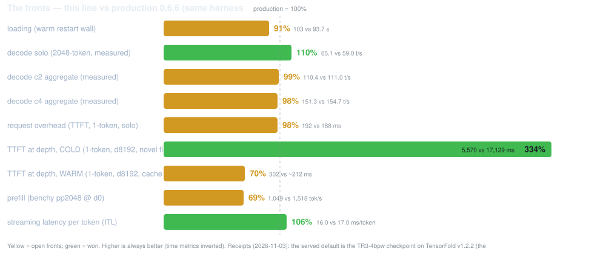

# What differs from the EXL3 recipe, and why

> **RETIRED COMPARISON (the round-139 (user) re-target)**: the Python recipe
> (MiaAI-Lab's GLM-5.3-Flash-EXL3-2x-DGX-Sparks-TensorFold) is RETIRED — its
> GitHub repo points here. **Production IS this repo's promoted native line**
> (it serves opencode on 8000); comparisons are NATIVE-vs-NATIVE: the current
> production against the current testing arm, both on the same window. The
> Python-era percentages below are HISTORY — the operative floor is the
> native-native pair (the anchors' duel rows; the retired recipe's numbers
> never cross-compare). The section below the separator is the pre-re-target
> record, kept for its receipts.

**The current state (round 141, 2026-11-11, the re-pair)**: the engine is TensorFold
**v1.2.6** (`6e9af9302`) + the **adopted 19-patch stack re-anchored** (the
round-trip proven byte-identical — pristine v1.2.6 + the 18 rebase patches,
plus the round-141 #2793 shared-budgets port 022). The v126val battery QUALIFIED the bump on every instrument
(campaign-20261110-162034): the same-bits greedy witness IDENTICAL (the
`80cc3802…` sha holds across the bump), the §2 gates ALL PASS, **hardmode 95
— now the TWENTY-FIFTH consecutive** (windows 36–37 added three more
all-pass serves), the vision 4/4, zero strict-TF_ refusals,
the walls 84/83 s, prefill 1,523, steady-state decode 73.1 tok/s. Production
serves opencode on 8000 from this repo's config. **Vision is ON as the
standing default and receipted** (the vision suite 4/4 in every battery since
round 132). **The #2699 prompt-cache question is CLOSED** (window 36,
campaign-20261110-215136): the value-first battery ran end to end — the flag
placed (16 kept states funded, 3.6 GiB) but the value gate MISSED on both
instruments (the within-session resume delta and the multi-turn TTFT: the
page cache over the pool's pages already delivers the resume value cacheless)
at the price of the third 512K window + 1 GiB of stream room — **the
cacheless standing HOLDS** (`PROMPT_CACHE_GIB` stays empty); the question
closes as upstream data, no third reshape. **The #2181 live-half candidate
is MEASURED OUT** (window 37, campaign-20261110-225305): the value gate
missed (5 of 16 slots funded cacheless vs the OFF arm's 3; the eviction
warning stays; the slot count tracks the run's room) while the mechanism
itself reproduced on our shape — the keep cost −31%, enough-for-3 held, the
greedy sha identical, every guard green — **no adoption**; the unplanned
composition datum (DRAFTS=0 + LIVE_HALF: enough for FOUR at 512K, 10 of 16
slots) is recorded as upstream data. The loop's discipline layer (the
stage brief, the value gate, the phase-lint, the phase-name gate, DRY_RUN,
the hit-rate watch) governs launches per the round-140 cont. 5 (user)
direction.

---

# The pre-re-target record (the Python-recipe comparison era — HISTORY)

This repo is a **testing line** for the native engine, next to
[MiaAI-Lab's GLM-5.3-Flash-EXL3-2x-DGX-Sparks-TensorFold](https://github.com/MiaAI-Lab/GLM-5.3-Flash-EXL3-2x-DGX-Sparks-TensorFold)
(our production). Both serve the **same checkpoint** — the difference is the
engine and the patch policy. Read this before pointing real traffic at it.
*(Updated 2026-11-07 after the v1.2.3 rebase, the KV_SHARE adoption and the round-133/134 patch adoptions (packed-s2, exl3prompt, attnfetch8) — receipts in
docs/LAUNCH.md and docs/TOOL_EVAL_TESTING.md; this repo's edits are AI-generated, see the
README. The engine is **v1.2.4** (`267c5af6a`, round 135: the 8-patch stack rebased and QUALIFIED —
§2 gates ALL PASS, hardmode 95 (the eighth consecutive) + the vision 4/4, zero strict-TF_ refusals
under #2405, the arms content-identical — v124val, campaign-20261107-132414; the v1.2.3-era receipts
stand: the fp8-paged + bf16 gate cells, the depth ladder 12/12, the replay 100 + the probe 5/5) with
**TF_KV_SHARE=16** adopted (v1.2.4 renamed the knob — the old TF_GLM_KV_SHARE refuses at startup —
and floored it at 4×PARALLEL; the prompt states as pool pages — the concurrent 4-prefix resume −40%
receipted at 8 on v1.2.3's mechanism, kvshare2/kvsharequal, campaign-20261106-092703/-093921; the
native store at 16 boots clean, v124val) and **`TF_GLM_INDEX_CUDA=1`** as the
standing default (round 49: the depth ladder −2.6% at 131k → −5.5% at 393k, gates ALL
PASS). The served default is the **TR3-4bpw checkpoint** (the round-132
(user) swap after the 4bpw sweep: 94/104 hardmode, the best top-8 decode —
docs/bpw4-sweep-cards.svg; the AZ-Focus stays receipted at 93) — the **(user) call: hardmode is THE quality
measure, target = beat production's run-level 94 or come close**. On the
CURRENT instrument (the 104-scenario hardmode battery): the served config **95** (receipted three
times: campaign-20261106-043015/-065920/-093921 — byte-identical token profiles), production's stock **92**, the Focus **92**, the AZ top-4 **87** — the **re-sweep (2026-11-06, docs/bpw4-sweep-cards.svg): all four packs on the SHIPPING stack; the served pack 3 points clear** (the round-132 v1.2.1 sweep's 93/94/90 is history) — and **production's current-bench anchor: 94/104** (the prodbench
receipt, campaign-20261102-213954: the same bench_cell instrument on the clean 8001) — **the served config is a point ABOVE production at the bar**. On the
OLD bench eras: the Focus scored 92 (round-38), the top4cfg 89 (76% subset) — the
eras are not cross-comparable (the (user) rule: hardmode scores never cross families
or bench versions). **The CURRENT scoreboard (the SHFL duel re-pair, 2026-11-08 —
campaign-20261108-010714: production-for-testing on 8001 vs ours on the adopted
13-patch engine, both engines the same window, the same probes)**: loading **112.9% — CROSSED** (83 vs 93.7 s —
the v1.2.4 wall on the direct reads, 008-loaddirect on the resharded pack, the
timed walls 83/83 s, v124val campaign-20261107-150250; the v1.2.3-era wall 103 s = 91%),
solo **115.2% — CROSSED** (67.2/67.7 vs 58.6/58.5 t/s — every row holds within noise on
the SHFL engine, decode-neutral as the A/B read), c2 **107.2% — above production
even at its top-of-range volley** (118.0 vs 110.1 this run; its floor
86.4 — 136.6% there; the record 118.6 stands), c4: production **at its floor this run** (168.0 vs 154.5 — **108.7%**; its
range 155-241 with cache state; ours 153.7 → 157.4
→ 158.6 → 160.2 → 166.1 → 168.8 → 168.9 → 168.0 across the windows — the record 168.9, held
at 168+ four windows), TTFT overhead
**99.5%** (183 vs 184 ms), ITL **116% — crossed** (14.8 vs 17.1 ms/token), **the cold depth
cost CROSSED (449%)** — ours 3.8 s vs production's 17.1 s true cold at d8192 (ours 3,812 ms,
slope 0.443 — the prefill levers show at depth too; production's cold slope 2.026 ms/tok,
slowing with depth; the 2.5 s it
shows in-window is its persistent cache, not cold) — and the **prefill front 100.1% — CROSSED, the last uncrossed (user)-bar front falls**
(1,519 vs 1,518 tok/s — the P2 packed-prompt loads' lever, bench pp d0 1,519 vs the 1,495 the exl3p window read
and the 1,458-1,468 before it; the A/B's TTFT slope 0.448 → 0.441 agrees; production the round-129 same-day pair,
campaign-20261031-171731; exl3prompt took the front from 76% to 94.4%, the attention
prefetch to 96.0% — the v1.2.4 benches read 1,461/1,406/1,449, inside the noise). The
MOESIDE duel on v1.2.3 (campaign-20261107-092913: solo 112.3%, c2 129%, cold 429%), the
ATTN8 duel (campaign-20261107-020420: solo 109.4%, cold 434%), the
EXL3P duel (solo 108.9%, cold 414%), the S2 duel (solo 109.2%, cold 340%) and the PAGED
duel (solo 108.5%, cold 328%) are the history it superseded. The round-132 window-mode duel (campaign-20261102-210117: solo 110%, c2 127%, c4 80%,
ITL 109%, cold 309%) is the pre-pages history it superseded; the Focus cell's round-130
head-to-head and the round-131 prodcold receipt are the cold front's provenance (the
round-131 receipt: production's TRUE cold on novel fills its persistent cache cannot hit).
The Focus cell's scoreboard (the round-130 head-to-head, 2026-10-31 — the first two-arm
duel since the port split, campaign-20261031-200757:
production started FOR TESTING on 8001, ours on main): **loading 98.6% — TAKEN** (95 s vs
93.7), solo **93.2%** (54.9 vs 58.9), c2 **80.5%** (89.0 vs 110.6), c4 **75.2%** (144.9 vs
192.6), ITL **102% — crossed** (16.6 vs 17.0), TTFT overhead **92.5%** (200 vs 185),
**prefill 69%** (the bench pair 1,049 vs 1,518), depth 12/12, hardmode 93 (the standing
ceiling); **the depth front has its final honest shape (the round-131 prodcold receipt —
production's TRUE cold on novel fills its persistent cache cannot hit)**: COLD we win 3.1×
(ours 5.57 s at d8192, slope 0.656 ms/tok flat, vs production's 17.13 s, slope 2.026 — its
cold prefill SLOWS with depth) — **the cold depth cost is CROSSED (309%)**; WARM
re-measured on v1.2.1 (cont. 25): our same-session hit is **0.302 s** vs
production's 0.21 s full-hit skip — **70%** (the round-131 v1.2.0-era number
was 1.42 s; the #1868 page-cache fix the likely mover — both receipts cited in
the anchors row); the open pieces are the cross-restart resume path and the
concurrent resume's 4× serialization. The round-130 "42%" and the round-130 "166%" both compared across cache
states (our cold vs its warm; our warm vs its warm-from-history). The
marks-policy patch is the fix candidate). The old score rows (92/100 etc.) are formally
cross-version history.
Production's patch series changed
(Mia's 0109-0122 + 0128-0129 + the 0088 NoRoom fix on the python-0.6 tip) and the bench
moved to v3.0.1 — all three serves are re-baselined on it (rounds 35/37). Both engines are
token-deterministic; all §2
gates PASS on both, including the modified checkpoint's battery.)*

## The engine

| | EXL3 recipe (production) | this repo |
| --- | --- | --- |
| Engine | TensorFold **Python 0.6.x** in a PyTorch-based image, plus a 122-patch recipe (Mia's series folded onto the python-0.6 tip, 2026-10-27) | TensorFold **native** (`tensorfold-native`, Zig, no Python) at a pinned commit — **v1.2.4 (`267c5af6a…`, the round-135 rebase — qualified by v124val: §2 ALL PASS, hardmode 95, the vision 4/4) + the 14-patch stack (the re-anchored absorb port, the fp8-pages marriage, the pagerows fix, the selist fix, the packed-s2 two-stage prompt matmuls — adopted cont. 86: the content bit-identical, pp +3.4/+5.8/+6.7%, the duel re-paired solo 109.2% / cold 340% — round 133: ADOPTED on v1.2.2 (§2 gates PASS, the duel re-paired, hardmode 95 + the vision 4/4), re-anchored onto v1.2.3 the same day and re-validated — v123qual, campaign-20261106-065920: the replay 100 with the standing run's exact token profile (total_tokens 662,693 byte-identical), the probe 5/5, hardmode 95 + the vision 4/4); the exl3prompt one-call EXL3 prompt path (the down kernel writes the MoE slot rows; no target-MTP prompt absorption beside a drafter — Mia 1104 0007+0008 hand-ported, byte-identical to the port commit on a fresh checkout) — adopted cont. 89: the content bit-identical across arms (campaign-20261106-201824), pp +24.5/+22.7/+23.3% at d0/d4096/d8192 — exceeding Mia's +12.6-16% combined claim — §2 PASS, hardmode 95 (the fifth consecutive) + the vision 4/4, the duel re-paired solo 108.9% / cold 414% / prefill 94.4% (exl3qual, campaign-20261106-212157); the attnfetch8 FP8 key-tile prefetch (the latent attention loads 8 bytes at a time, a tile ahead — Mia 1104 0005+0011 hand-ported onto the paged marriage, `glm-zz-` named to sort after the stack) — adopted cont. 96: the content bit-identical everywhere incl. the 2048-token decode replies (campaign-20261107-010849), bench pp +1.7/+3.6-4.3% and tg +2.9-10.9% at depth, §2 PASS, hardmode 95 (the sixth consecutive) + the vision 4/4, the duel re-paired solo 109.4% / cold 434% / prefill 96.0% (attnqual, campaign-20261107-020420); the moeside side-stream overlap (a decode window's MoE shared expert on a second stream beside the routed experts — Mia 1104 0006+0010 hand-ported, `glm-zz-` named to sort after the stack; TF_GLM_SHARED_SIDE=0 the kill switch) — adopted cont. 100: the content bit-identical everywhere incl. the 2048-token essay replies (campaign-20261107-083254), the steady-state probe resolved (the off arm 51/51 s, both on-runs faster, +3.0% 4/4 sign-consistent), §2 PASS, hardmode 95 (the seventh consecutive) + the vision 4/4, the duel re-paired solo 112.3% / c2 129% of the floor / c4 158.6 (moesidequal, campaign-20261107-092913); TF_KV_SHARE=16 (v1.2.4 renamed the knob and floored it at 4×PARALLEL — the prompt states as pool pages, the concurrent 4-prefix resume −40% receipted at 8 on v1.2.3's mechanism, adopted 2026-11-06, cont. 74); 008-loaddirect (round 135: the layer loads on v1.2.4's checkpoint.direct — the loading wall RE-DATED: 83/83 s vs production's 93.7 — **112.9%, the loading front CROSSED**, v124val campaign-20261107-150250, on the resharded 55-shard pack); 012-zmoe-fuse (round 136: Mia 1104's 0030 — a decode window's MoE glue fused + one-width EXL3 decode tiles + KDA's f_b/g_b in one launch, `TF_GLM_MOE_FUSE=0` unfuses) — adopted round 136: the arms' content identical to the byte (the moefusequal A/B, campaign-20261107-172250), §2 PASS, hardmode 95 (the TENTH consecutive) + the vision 4/4, c4 166.1 vs the unfused arm's 159.4 (+4.2%, our best c4), c2 +1.0%, ITL −1.5%, solo flat, prefill flat by design); 013-zprompt (round 137: Mia 1104's 0078+0079 — the prompt experts' main loop reworked (8-member column blocks, the next k tile decoded among the current MMAs, per-item cp.async, mcg2/decode_a8/fwht128f, vector stores; the fork measured the kernels gu 1.177× / down 1.161×), `TF_GLM_EXL3P=0` resolves the classic `_cl` twins) — adopted round 137: the arms' content identical to the byte (the exl3pqual A/B, campaign-20261107-200411), §2 PASS, hardmode 95 (the ELEVENTH consecutive) + the vision 4/4, **the prefill front 96.0% → 98.5%** (bench pp d0 1,495 vs the 1,458-1,468 the last three windows read; the TTFT slope 0.458 → 0.447 agrees), decode flat within the arm spread); 014-zs2 (round 137: Mia 1104's 0080 — the packed prompt GEMMs' loads fixed once a block + 8-bit codes to bf16 pairs in fewer steps (mm_kernel's P2: per-thread cp.async pieces once a block, `bpairs8_fast` two LOP3s + one rounding-free bf16x2 subtraction; the fork measured the packed prompt linears 1.116-1.138× at GLM's prompt shapes), `TF_GLM_MM_P2=0` resolves the classic `_128s2_cl` twins) — adopted round 137: the arms' content identical to the byte (the 0080qual A/B, campaign-20261107-214342), §2 PASS, hardmode 95 (the TWELFTH consecutive) + the vision 4/4, **the prefill front CROSSED at 100.1%** (bench pp d0 1,519 vs production's 1,518; the TTFT slope 0.448 → 0.441 agrees), decode flat within the arm spread); 015-zshfl (round 137: Mia 1104's 0081 — the exl3r read-once trellis, `TF_EXL3_SHFL=0` restores the old choice) — adopted round 137 cont. 8: content identical, hardmode 95 (the thirteenth consecutive), decode flat on our shape (the fork's −14% claim did not transfer — the first not to; adopted for bit-safety + the 0082 base); 016-zstep (round 138: Mia 1104's 0082 — the read-once chain as dependent launches, `TF_EXL3_PDL=0` turns it off) — adopted round 138: content identical, hardmode 95 (the fourteenth consecutive), decode flat on our shape (the launch-overlap class did not transfer — the second not to; adopted for bit-safety + the 0083 base); 022-shared-budgets (round 141: upstream #2793 cc2fa8d23690, fixes #2720 — DFlash2's shared draft rounds priced every stream's drafts by last grant + slack without the budgets rule, so a BLOCKED lane ratcheted its stream to zero drafts while peers decoded; the fix `.allocate_shared_drafts = drafting and !block`) — adopted round 141: the greedy TEXT sha identical on all three serves, §2 ALL PASS, hardmode 95 (the THIRTY-SECOND consecutive), the vision 4/4, **the value gate CROSSED at +6.1%** (the room-matched c4 180.4 vs the OFF arm's 170.0 t/s — beyond upstream's own 3.7% greedy claim; the gradient solo +1.0%/c2 flat/c4 +6.1% confirms the mechanism; campaign-20261111-094017, the first VALID room-gated value reading on this line); paged KV mainline** |
| Checkpoint | Mia-AiLab EXL3 4 bpw (~176 GB) stock + DFlash2 drafter | **the TR3-4bpw checkpoint (the (user) default, 2026-11-02) + DFlash2** — a different checkpoint from production's, chosen on the hardmode bar; the stock and top4cfg Mia cells remain serveable (`MODEL_ID`/`MODEL_REVISION`/`PATCHES` per the README). This line is EXL3 only — the NVFP4 route (NVIDIA's checkpoint, MTP drafts, the v1.0.x receipts) has its own repo (GLM-5.3-Flash-NVFP4-2x-GB10-TensorFold-v1-testing) |
| Code carried locally | a patch series against TensorFold's site-packages | **none** — upstream code, built at a pinned commit |
| Upgrade path | rebase the patch series by hand (see the old repo's REBASE-NOTES) | bump `TF_REF` (or take the default `latest-v1`); prepare rebuilds the image |

The native GLM CUDA family landed upstream in PR
[#804](https://github.com/ashhart/TensorFold/pull/804) (tracked in
[#593](https://github.com/ashhart/TensorFold/issues/593)); the EXL3 two-rank reader and
DFlash2 drafter are #855/#976 and #979, first released in **v1.1.0**.

## Where the two engines stand, measured on this pair (2026-10-23)

Production 0.6.6 and this line have now been measured **with the same harness** (the
qualification campaign's prodqual round):

- **Exactness: parity.** All §2 gates (drafted=plain, resumed=fresh, concurrent=solo,
  seeded sampling) pass on both engines, in the same content form; both are
  token-deterministic at greedy (`choices` byte-identical across runs). Production's
  "drafted replies still equal serial ones" guarantee replicates on the native engine
  with fp8 KV — on dense8 and dense4 both.
- **Decode: parity in steady state.** Solo ~54 t/s (native, dense4fp8) vs ~52 t/s
  (production, derived from its bench rows); aggregate decode rises with streams on
  both (native c4 ~99–110 t/s, production ~104). The long-believed native
  "concurrency cliff" was a bench artifact — tg128 rows divide by total time, so
  prefill polluted them at depth ([ashhart/TensorFold#918](https://github.com/ashhart/TensorFold/issues/918)'s
  cross-backend gap does not show in steady-state decode at this scale).
- **Prefill: production leads ~49%** (1,530 vs 1,025 pp2048). Section profiling
  (TF_GLM_PROF) shows our prompt passes are **90% router+routed** — the gap is the MoE
  expert path in prefill, not attention. This is the main remaining performance
  difference and it is upstream's to close.
- **Loading: TAKEN (round 127/129) — 95 s vs 93.7 s (98.6%)** on v1.2.0 + the tail release — the
  metric front (2026-10-23, the user's bar) is closed. The pre-v1.2 walls were ~265 s. Cause unmeasured: the candidates are the
  load-time packing (dense4/head4 pack at load), the DFlash2 drafter load, or the
  two-rank orchestration; the campaign's knobs phase records the engine's own
  "loaded in" line vs the wall per cell to split them.
- **Quality: production leads 3 points** (95 vs 92 tool-eval, same harness, same seed),
  entirely in the structured-output scenarios (nested schema / enum / multi-tool) —
  an engine-level decoding-path difference, config-independent on our side.
- **Short generations: production leads on TTFT** (1,339 vs 1,999 ms at d0) and on the
  bench's tg-at-depth numbers — which measure prefill+decode together. For chat-style
  short replies production feels faster; for long generations the two engines match.
- **Context: this line is qualified at 524,288** (5 streams, fp8 KV, dense4fp8);
  production's window is the same. The ladder receipts are in
  docs/CONTEXT_512K_PLAN.md.

  

## Honest caveats (as of 2026-10-23)

- **Production remains the recommendation for serving.** It wins prefill, TTFT, short
  generations, and the tool-eval score. This line exists to qualify the native engine
  and it now has the receipts to do that — but "qualified" is not "faster".
- **The native line is still a preview upstream.** The §2 exactness guarantee
  (drafted=plain, resumed=fresh, concurrent=solo) is *our* receipt now, on *our* pair —
  not just upstream's — but upstream's own release notes remain the contract.
- **Vision: upstream has it, we have not run it.** 1.1.0 added `--vision` for GLM EXL3
  two-rank (images and video; video needs libtfvideo). Untested on this pair; anything
  that sends images stays on production until validated.
- **DFlash2 via `--drafter`** (CC BY-NC-ND 4.0, non-commercial) passed automatically
  when the snapshot is present; without it the server falls back to the MTP head (with
  a warning), and `DRAFTS=0` is the serial reference — verified byte-equal in content
  by the gates.
- **TP=2 only**: the native ranks meet over `NCCL_COMM_ID`, and a third rank on a two-host
  cabled pair has no bootstrap interface. The old stack's `start-tp3.sh` stays Python-only.
- **Upstream watch** (docs/ECOSYSTEM.md): #1163/#1211 bring GLM KV paging
  (`TF_KV_PAGES`) — streams become 512-row pages instead of whole windows, which could
  raise the 5-stream admission ceiling; #1080's prefill work is qwen/attention-targeted
  and does not address our MoE-bound prefill gap; #1215's round-class GPU timers are the
  instrumentation pattern to ask for.

## What carries over (and is why this is still worth testing)

- Same topology and wiring: rank 0 on the head, rank 1 over ssh, NCCL over the two CX7 rails,
  the same docker run contract (`--network host`, `/dev/infiniband`, `IPC_LOCK`, memlock).
- The rank checks upstream added are strong: before serving, both ranks verify they run the
  same build, cut and **checkpoint bytes** (sha256 of every shard), and a dead rank stops the
  other within about a second.
- Admission across ranks: every rank's free memory is gathered after loading and the server
  admits by the smallest, naming a rank that refuses — the refusal line prints its own
  arithmetic, which is how the 5-stream ceiling at 512K was established.
- Zero local patches: upstream fixes and speedups land by bumping the version, not by rebasing
  a 106-patch series by hand.
- The qualification harness itself: one command runs the gates, the depth probes, the
  tool-eval, the throughput tables and the ladder, with production guarded and every
  phase receipted — rerunning it after any engine bump is the whole cost of staying honest.
